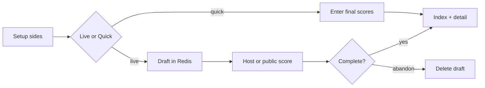

# Quick Match (Practice)

## Decisions locked in
- **Scoring modes:** both live (full point/set engine) and quick final result
- **Create / view history:** anyone on the site (no PIN to open Practice)
- **Concurrency:** many practice matches can run in parallel (each has its own id/link)
- **Live scoring auth:** **host by default**; optional **“Allow anyone to score”** toggle at create. Host always can score; if toggle on, anyone with the link can score
- **Abandon:** only the **creating browser** (host token) **or Admin PIN**
- **Delete completed:** **Admin PIN** can remove a completed practice from history (and delete its doc)
- **Quick result:** sets won required; per-set scores optional
- **Persistence:** save only when **completed**; abandon deletes draft — not in history
- **Teams:** manual two sides — search master players + type new names; practice teams are session-only (not master roster)
- **History:** list + open match for set-by-set detail (and event replay when live-scored)
- **Storage:** practice is **global site data**, fully isolated from every tournament — including while an active season is live

## Hard isolation (global practice ≠ tournaments)

Practice must never ride on the active tournament key, `?season=`, or season config/matches.

| Must NOT | Must |
|----------|------|
| Keys like `{tournamentKey}:config` / `{tournamentKey}:m:*` | Only `tnhvpl:practice:*` keys |
| Write into season `teams` / `players` / `fixtures` / `awards` | Own `PracticeMatch` documents + practice index |
| Appear in standings, fixtures, awards, or season admin | Own `/practice` UI only |
| Depend on `loadState(season)` for practice CRUD | Dedicated `lib/practiceStore.ts` (or equivalent) |
| Merge ad-hoc practice names into master catalog | Catalog = read-only picker; practice writes stay in practice keys |

Even when the site is serving a live tournament, practice create/score/complete/history use the global practice store only. Tournament Redis keys and practice Redis keys share a database connection if configured, but **different key namespaces** — no shared documents.

## Data model (global practice store)

Site-wide keys (not under any season prefix / not merged into catalog):

- `tnhvpl:practice:index` — list of completed practice match summaries
- `tnhvpl:practice:m:{id}` — full practice match document (draft or done)

```ts
// PracticeMatch (sketch)
{
  v: number;
  id: string;
  status: "draft" | "live" | "done"; // drafts abandoned are deleted
  mode: "live" | "quick";
  createdAt: number;
  completedAt?: number;
  hostTokenHash: string; // hash of secret returned once to creating browser
  allowPublicScore: boolean; // default false; if true anyone may POST score
  labelA: string;
  labelB: string;
  sideA: PracticePlayer[];
  sideB: PracticePlayer[];
  format: Format;
  ev: MatchEvent[];
  setsWon?: { a: number; b: number }; // required on quick complete
  setScores?: { a: number; b: number }[]; // optional detail
}
```

- On `create`, server returns `{ id, hostToken }` once; client stores `hostToken` in `localStorage` keyed by match id. Abandon/complete-as-host sends that token; Admin may abandon with `x-pin: ADMIN_PIN`.
- Ad-hoc players: stored only on that practice match; **never** written to [`lib/catalog.ts`](lib/catalog.ts) / season configs.
- Catalog pick: copy name/skill/photo from [`GET /api/catalog`](app/api/catalog/route.ts) at add time only.

## API

New routes under `app/api/practice/`:

| Action | Behavior |
|--------|----------|
| `GET /api/practice` | Completed history (newest first) |
| `GET /api/practice/[id]` | Full match (draft or done) |
| `POST create` | Create draft with sides + format + mode |
| `POST score` | Live actions if not done; host token **or** (`allowPublicScore` and no token) |
| `POST quickResult` | Sets won required; optional per-set scores → complete (host token) |
| `POST complete` | Mark live match done when engine finished; append to index (host token) |
| `POST abandon` | Delete draft/live; host token **or** Admin PIN; no index entry |
| `POST delete` | Remove **completed** match from index + store; **Admin PIN** only |

Reuse [`derive` / `checkAction`](lib/engine.ts) with the practice `format` (same as tournament scoring).

## UI

- Nav: add **Practice** in [`components/Nav.tsx`](components/Nav.tsx) (not season-scoped).
- [`app/practice/page.tsx`](app/practice/page.tsx) — history list + **New quick match**.
- [`app/practice/new/page.tsx`](app/practice/new/page.tsx) — setup:
  - Team A / Team B labels
  - Per side: search master players, add ad-hoc name, remove with confirm
  - Format presets (or short editors)
  - Checkbox **Allow anyone to score** (off by default)
  - **Start live** vs **Enter result**
- [`app/practice/[id]/page.tsx`](app/practice/[id]/page.tsx) — draft/live: scoring UI (disabled for non-host if `allowPublicScore` is false); done: set-by-set + events. **Abandon** for host or admin. Completed detail: admin **Delete from history**.
- Quick result form: **sets won** required; **per-set scores** optional → save as completed.
- History page lists completed only; “Your open practices” from localStorage host tokens.



## Isolation rules (implementation checklist)
- New module for practice persistence — do **not** extend `updateConfig` / `updateMatch(prefix, …)` for practice.
- Practice API routes under `app/api/practice/` — no `season` body param that changes storage prefix.
- Nav **Practice** link is not season-scoped (`/practice`, not `/?season=…`).
- Master list is **read-only** for player pickers; never call `saveTeams` from practice flows.
- Tournament standings / fixtures / awards / admin season data remain unchanged by practice traffic.
- Optional smoke check: complete a practice while viewing an active season → season `config`/`matches` keys unchanged; only `tnhvpl:practice:*` keys change.

## Defaults
- Default format: best of 3, targets `21,21,15`, win by 2 (same spirit as league).
- Team labels default to "Team A" / "Team B".
- History capped in UI to recent ~50; full list still loadable via API.

## Out of scope (this pass)
- Practice stats leaderboards
- Linking practice players into tournament seasons
- Host self-delete of completed matches (admin-only delete is enough)

## Ready to implement
All product questions answered. Await explicit go-ahead to build.
