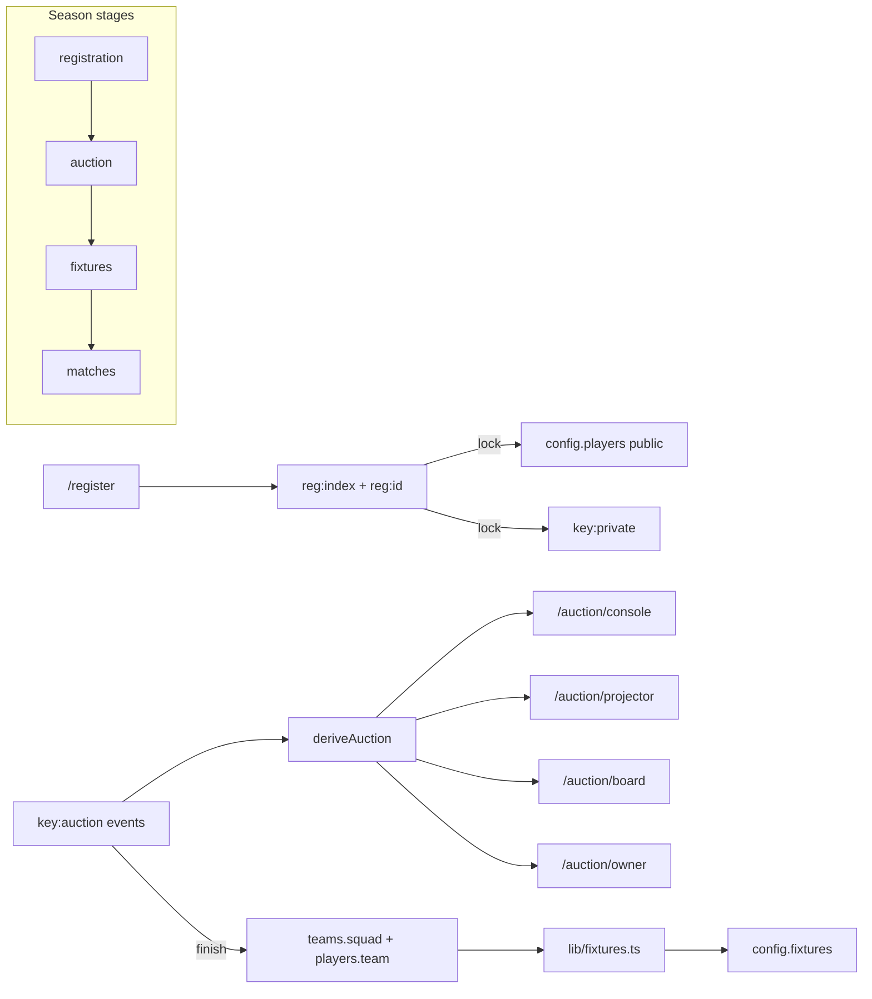

# Season Workflow (Registration → Auction → Fixtures → Matches)

## Decisions locked in
- **Stages:** `registration → auction → fixtures → matches → completed`. Missing `stage` on legacy seasons ⇒ treat as `"matches"` (no new locks).
- **Clone from S5 (mode A):** keep team shells (id, name, short, color, owner display name, logo) with **empty squads**; clear `players` and `fixtures`; copy Season 5 auction + registration setting defaults; do **not** copy registrations, `{key}:private`, auction log, or owner PINs; set `stage = "registration"`.
- **Blank seasons:** `stage = "registration"` + same defaults; empty teams.
- **Cadence:** implement **one phase at a time**; after each: `npm test` + `npm run build`, short try-it summary, wait for go-ahead.
- **Docs:** on start of Phase 1, move `season-workflow-pack/docs/season-workflow/` → [`docs/season-workflow/`](docs/season-workflow/) (pack README intent); keep root [`PROMPT.md`](PROMPT.md) or point it at the moved copy.
- **Owners:** display name on [`Team.owner`](lib/types.ts) stays; **owner login** is a separate per-team hashed PIN in `{key}:owners`. Owners are not in the bid pool; `ownerCountsInSquad` defaults false (S5).
- **Roles:** existing `admin` / `scorer`; add `auctioneer` (`AUCTIONEER_PIN`, admin PIN also works) and `owner` (team pick + PIN). Hash: **scrypt** with per-season salt.
- **Privacy:** phone, tower, age, email, availability, contribution never in `/api/state` or public/edge-cached payloads.
- **Auction:** event-sourced `lib/auction.ts` (mirror [`lib/engine.ts`](lib/engine.ts)); server validates every bid; draw via `crypto.randomInt`; S5 rules as defaults ([`docs/season-workflow/reference/season5-auction-rules.md`](season-workflow-pack/docs/season-workflow/reference/season5-auction-rules.md)).
- **Photos:** new registrations → `{key}:ph:{id}` + `/api/photo/...`; legacy data-URL and `/players/*.jpg` unchanged.
- **Fixtures:** generator writes existing `Fixture` shape so scoring/standings/playoffs stay unchanged.
- **Deps:** SheetJS tarball `xlsx@0.20.3` for import; `jszip` only if photo-zip needed; pin exact versions.

## Hard isolation
| Must NOT | Must |
|----------|------|
| Put private fields in `{key}:config` / `/api/state` | `{key}:private`, `{key}:reg:*`, `{key}:owners`, `{key}:auction` |
| Break `tnhvpl-s5` or practice (`tnhvpl:practice:*`) | Season-prefixed keys only for workflow data |
| Invent new storage patterns | Reuse [`lib/store.ts`](lib/store.ts) `readRaw` / `update` CAS + memory fallback |
| Change public `AppState` shape for existing clients | Optional config fields only |

## Architecture

## Data model (add to [`lib/types.ts`](lib/types.ts))
- `SeasonStage`, optional on `Config`: `stage`, `stageLog`, `registration`, `auction`, `fixtureGen`
- Extend `Player` with optional `id`; `PlayerPrivate`; `RegistrationEntry` / `RegistrationSettings`; `AuctionSettings` / `AuctionEvent` / `AuctionDoc` (as in PROMPT §2)
- Redis keys under season prefix: `private`, `reg:index`, `reg:{id}`, `auction`, `owners`, `ph:{playerId}`

## Key code touchpoints
- Store: extend [`lib/store.ts`](lib/store.ts) or add `lib/seasonStore.ts` / `lib/registrationStore.ts` helpers; change [`createTournamentSeason`](lib/store.ts) clone path for mode A + blank `stage`
- Auth: [`app/api/action/route.ts`](app/api/action/route.ts) `roleFor` / `checkPin` → `{ role, teamId? }`; [`StaffLogin.tsx`](components/StaffLogin.tsx) + [`LiveProvider.tsx`](components/LiveProvider.tsx) `StaffRole`
- Admin: stage bar + settings sections on [`app/admin/page.tsx`](app/admin/page.tsx); registrations at `/admin/registrations`
- Auction UI: `/auction/console`, `/projector`, `/board`, `/owner`; APIs `GET /api/auction`, `/api/auction/private`
- Pure logic + tests: `lib/auction.ts`, `lib/fixtures.ts`, `lib/registration.ts` (normalize/dupes/import); tests per PROMPT §11
- Defaults: [`lib/defaults.ts`](lib/defaults.ts) Season 5 auction/registration presets

## Phases (stop after each)

### Phase 1 — Foundation
- Move docs pack → `docs/season-workflow/`
- Types + defaults; `stage` on config; read-only stage bar in admin
- Private/photo/owners store helpers; `GET /api/photo/[key]/[id]`
- Roles: auctioneer + owner PIN set/check (hashed); StaffLogin Auctioneer/Owner
- Clone/blank behavior (decision A); `privacy.test.ts`
- **Out of scope this phase:** public register UI, auction engine UI, fixtures

### Phase 2 — Registration
- Public `/register?season=`; admin review/import (CSV/XLSX + photo zip); lock → players + private + numbering → `stage = auction`

### Phase 3 — Auction engine only
- `lib/auction.ts` + `tests/auction.test.ts` (max bid, leftover cap, stale bids, full 9/9/9/8/8 sim)

### Phase 4 — Auction API + console
- Actions + `/api/auction*`; auctioneer console (draw/reveal/bid/sold/unsold/undo/keyboard)

### Phase 5 — Projector, board, owner
- Three screens; 1s poll; owner optimistic bid; timer/anti-snipe settings

### Phase 6 — Finish auction + fixtures + server stage locks
- Lock squads; `lib/fixtures.ts` + admin preview/edit; enforce locks in `/api/action`

### Phase 7 — Exports, README, e2e
- CSV/squad sheet; `AUCTIONEER_PIN` docs; `scripts/season-e2e.mjs`

## Acceptance (from PROMPT §13)
Clone → register/import/lock → auction with concurrent owners → finish squads → generate S5-quality fixtures → score; `tnhvpl-s5` unchanged; no private leakage in `/api/state`.
